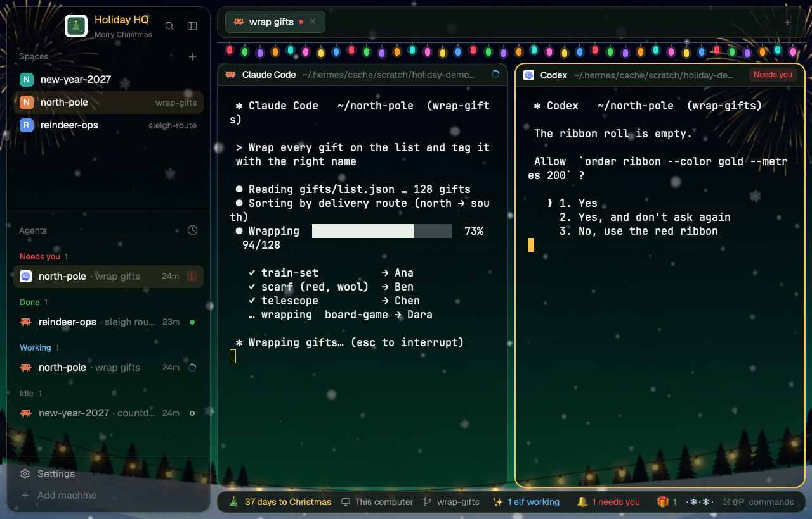

# Holiday HQ — a Herdr layout

Version 1.00. A Christmas and New Year layout for the [Herdr app](https://herdr.dev): a snowy night
sky behind dark 50% glass panes and sidebar, glowing fairy lights in eight colours, and a status
bar that counts down to Christmas and the New Year.



## Install

Copy into your Herdr home (`~/.config/herdr-app`), without overwriting anything you already have:

```sh
cp layouts/holiday.json ~/.config/herdr-app/layouts/
cp layouts/holiday.png  ~/.config/herdr-app/layouts/
cp themes/holiday.json  ~/.config/herdr-app/themes/
cp -R mods/holiday-brand mods/holiday-lights mods/holiday-status ~/.config/herdr-app/mods/
for m in holiday-brand holiday-lights holiday-status; do herdr-app check ~/.config/herdr-app/mods/$m; done
herdr-app do layout.switch '{"name":"holiday"}'
```

`ctrl-shift-l` (`cmd-shift-l` on macOS) switches back to your own layout.

The mods don't run programs (`exec` or `hc`), don't use the network, and don't read files outside
`~/.config/herdr-app`.

`RECIPE.md` is the brief another agent can use to build this layout from an empty folder.
