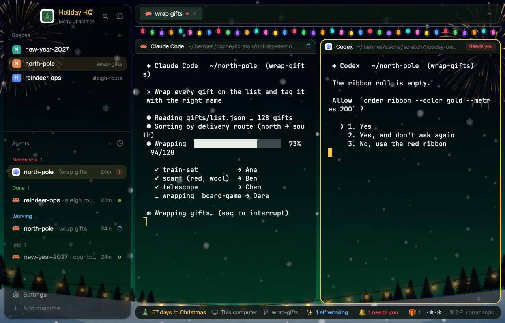

# Holiday HQ

Version 1.00.

A Christmas and New Year layout for the Herdr app. A dark, snowy night sky fills the window, and
the sidebar and terminal panes are sheets of dark glass at 50%, so the sky shows through them. A
sidebar on the left holds a little Christmas-tree sign that cycles through holiday greetings.
Under the tab bar hangs a string of glowing fairy lights in eight colours. They twinkle on their
own, and all blink fast together when an agent needs you. The status bar
at the bottom counts down to Christmas, then to the New Year, and reports your agents as elves
working, gifts ready, and so on. Snowflakes drift in the corner of the status bar.

## What you see

Left to right, with 8px of padding around the window and 8px between the cards:

- **Window background:** a full-window image, `mods/holiday-brand/night.jpg` (1920×1080 JPEG,
  `fit: cover`). It shows a midnight navy-to-pine sky with falling snow, faint gold fireworks in
  the top corners, and a snowy hill with pine silhouettes along the bottom. The center is kept dark
  so the glass reads on top of it. It shows in the gutters, and at half strength through the
  sidebar and the panes.
- **Sidebar, 268px wide, dark glass** (folds to a 76px rail on macOS, 44px elsewhere). Background
  `#03060580` (near-black pine at 50%), 1px white glass edge `#ffffff2e`, radius 14, medium
  shadow. The mods inside paint nothing of their own (`chrome` is clear), so the whole sidebar is
  one even 50% layer. From top to bottom:
  - **Sign, 50px tall** (drags the window). A 30px Christmas-tree tile (`tree.png`, radius 7),
    then **"Holiday HQ"** in semibold 14px gold `#f5c451`. Under it, in 10px dim text, a greeting
    that changes every 3.5s: "Merry Christmas", "Happy New Year", "Season's greetings",
    "Peace & joy". On the right are a search button (opens `picker`) and a fold-sidebar button,
    both 26px. On hover they turn gold. On macOS the row starts 76px in so the traffic lights fit
    (they sit at 12, 16).
  - **Spaces** (shipped `spaces` mod), 2 shares of the height, at least 90px.
  - **Agents** (shipped `agents` mod), 3 shares of the height, at least 90px.
  - **Footer, 69px:** "Settings" and "Add machine" rows, each 28px tall, with 14px icons. A gold
    6px dot shows next to Settings when an app update is ready.
- **Work column** (fills the rest, with 4px gaps):
  - **Tab bar card, 42px** (shipped `tabs` mod, drags the window). Solid pine `#0c1613e0` with a
    1px gold-15% edge `#f5c45126`, radius 12.
  - **Fairy lights, 24px.** A thin `#3d5c4a` wire runs 2px from the top. Bulbs hang from it about
    every 24px across the full width, at least 4 of them. Each bulb is a 7×10px pill inside a
    13×15px glow (the bulb's colour at 25%), on a 2×3px cap. Eight colours: red `#ff4d5e`, orange
    `#ff9f1c`, yellow `#ffd23f`, green `#4cd964`, cyan `#2ee6d6`, blue `#4da3ff`, purple
    `#a970ff`, and pink `#ff6fd8`. Bulb *i* takes colour `(i × 3) mod 8`, so neighbours never sit
    in rainbow order. The bulbs hang 1, 3, 5, then 3px below the wire, so the string sags like a
    garland.
  - **Panes** (the active tab). Each pane is dark glass: background `#03060580` (50%), the
    terminal adds no background of its own (`terminal_opacity: 0`), a 1px white glass edge
    `#ffffff2e`, radius 14, and 8px between panes. The focused pane gets a 1.5px solid gold `#f5c451`
    border. Each pane has a 30px header (the shipped `pane` mod), and it shows even on a tab's only
    pane. Terminal padding is 16×14.
  - **Files and Changes panel** (shipped `files` and `changes` mods in a stack), 368px wide, hidden
    until you open it from the tab bar.
  - **Status bar card, 28px**, solid pine like the tab bar, radius 12, with 11.8px muted text. On the left:
    - The countdown, in semibold gold: 🎄 "N days to Christmas" (1 day reads "1 day"). On Dec 24
      and 25 it reads "Merry Christmas!". From Dec 26 it reads 🎆 "N days to 2027", and on the
      final day it switches to hours ("5h to 2027"). From Jan 1 to 7 it reads 🎆 "Happy New Year
      2027!". All dates use local time.
    - The space's machine ("This computer" or its name), shown with an icon.
    - The git branch, also with an icon.
    - Agent pills: ✨ "N elves working" (1 elf), 🔔 "N need you" (1 needs you), 🎁 "N gifts
      ready" (1 gift), and ❄ "N resting".

    On the right, always visible: "lights off" when the lights are switched off, a snow strip that
    cycles `❄ · ✻ · ❅` and its variants every 0.7s, and the palette hint ("⌘⇧P  commands",
    taken from your real binding). Below 900px of width, the machine and branch drop out. If the
    left side still doesn't fit, it clips instead of pushing the right side off.
- **Look:** theme `themes/holiday.json`. Its terminal background is `#0f1a17`, foreground
  `#e8efe9`, cursor gold `#f5c451`, and selection `#2c4a3d`. The 16 ANSI colors use the same
  festive red, green, gold and blue. Color overrides: accent `#f5c451`, chrome `#00000000`, canvas
  `#08100e`, surface `#15241f`, raised `#1d3029`, border `#f5c45126`, hover `#f5c45114`, selected
  `#f5c4511f`, working `#5eb1ef`, blocked `#e5484d`, done `#46a758`, idle `#8aa397`.

## How it behaves

- **Agent status**, in the status bar and the lights:
  - **working:** the blue ✨ "elves working" pill. The lights twinkle softly. Each bulb and its
    glow fade between 35% and 100% opacity on their own period, 1.1–2.6s, so the string never
    blinks in step.
  - **blocked:** the red 🔔 "need you" pill. The lights **keep their colours but all blink
    together, fast: every 0.52s, from 20% to 100%**. Click the pill to jump to the first blocked agent
    (`agent.focus`).
  - **done:** the green 🎁 "gifts ready" pill. Click it to jump to the first finished agent.
  - **idle:** the dim ❄ "resting" pill.
  - The Agents list in the sidebar shows each agent's own status, the way the shipped `agents`
    mod does.
- **Click the lights** to switch them off (gray bulbs, no glow, no animation). The status bar then shows
  "lights off". Click again to switch them back on. The setting is shared state `holiday.lights`
  and stays across restarts.
- **Hovering** the lights shows a tooltip ("Click to switch the lights off"). Hovering a sign
  button turns it gold.
- **Click** the palette hint to open the command palette, search to open the picker, and the
  fold button to fold or unfold the sidebar.
- **What moves:** the greeting text, the bulbs, and the snow strip. All of it is native animation
  (`frames`, `loop`), so no timer redraws the window. A once-a-minute timer refreshes the countdown.

## Built from

- **Layout `layouts/holiday.json`:**
  - root `row` (`titlebar: none`, `traffic_lights: [12,16]`, `padding: 8`, `gap: 8`, no
    divider, `theme: "holiday"`, `colors` as above, background
    `{image: "mods/holiday-brand/night.jpg", fit: "cover"}`, `terminal_padding: [16,14]`,
    `terminal_opacity: 0`, `preview: "layouts/holiday.png"`)
    - `sidebar` column (268px, min 44, max 480, `resizable: false`, glass paint, `shadow: md`)
      - `brand` block → mod `holiday-brand` (50px, `window_drag`)
      - `sidebar-lists` column
        - `spaces` → shipped `spaces` (weight 2, min 90)
        - `agents` → shipped `agents` (weight 3, min 90)
      - `sidebar-footer` → `holiday-brand` with `props: {footer: true}` (69px)
    - `work` column (`gap: 4`, `resizable: false`)
      - `tabs` → shipped `tabs` (42px, `window_drag`, card paint)
      - `lights` → `holiday-lights` (24px)
      - `work-body` row (`gap: 8`)
        - `main` = `{tab: "active", pane: {gap 8, radius 14, background #03060580, lone true,
          border {1, #ffffff2e}, focus {1.5, #f5c451}, header: {mod "pane", height 30, top,
          always}}}`
        - `panel` column (hidden, 368px), holding `panel-body` stack (`files`, `changes`)
      - `status` → `holiday-status` (28px, card paint)
  - "Card paint" means `background #0c1613e0`, `border {1, #f5c45126}`, `radius 12`. "Glass
    paint" means `background #03060580`, `border {1, #ffffff2e}`, `radius 14`.
- **Theme `themes/holiday.json`** (the background, foreground, selection, cursor and 16 ANSI
  colors listed above).
- **`mods/holiday-brand`** (`place: none`). Without props it draws the sign; with `footer: true` it
  draws the footer. It is adapted from the shipped `workspace-chrome`. It uses `layout()`,
  `shared` / `setShared("sidebar.width" | "sidebar.collapsed")`, `layout.resize {id: "sidebar"}`,
  `mod.open {picker | machine-add}`, `app.settings`, `updates()`, and `window()`. Art: `tree.png`
  (128px, AI-generated with FAL) and `night.jpg` (1920px, AI-generated with FAL), plus the
  `search`, `sidebar`, `settings` and `plus` SVGs copied from `workspace-chrome`.
- **`mods/holiday-lights`** (`place: none`). It counts the bulbs from `on_size_change`, reads
  `agents()` to catch blocked agents, and stores on/off in `shared("holiday.lights")`. It animates
  each glow (with its bulb inside) with `.loop("opacity", {from, to, period})`.
- **`mods/holiday-status`** (`place: none`). It uses `spaces()`, `panes()`, `focused()`,
  `agents()`, `keys()`, `window()`, and `shared("holiday.lights")`. It calls `agent.focus` and
  `app.palette`. It uses `.frames()` for the snow and `cx.timer.every(60000)` for the date. The
  `branch`, `monitor` and `server` SVGs are copied from `workspace-chrome`. The countdown is the
  exported `countdown(now)`.
- No `exec`, no network, and no files read outside `~/.config/herdr-app`.

## Watch out

- The `.loop()` periods must be at least 100ms. The `.frames()` interval must be at least 16ms.
  Never animate the lights with a timer: every redraw repaints the whole window.
- Bulb count comes from the measured width. Re-render only when the width changes by more than
  half a bulb spacing, or every resize causes a burst of re-renders.
- The status bar overflows easily. Put the countdown and pills in a `flex_1().min_w(0)
  .overflow_x_hidden()` row and the snow and hint in a `flex_none()` row. Otherwise the palette
  hint gets pushed off the edge. Drop the machine and branch below 900px.
- Use singular and plural forms ("1 elf working", "1 gift ready", "1 needs you").
- Image paths are relative to the Herdr home (`mods/holiday-brand/night.jpg`), not to the mod
  folder. Keep the art inside a mod folder so the layout travels as one piece.
- The glass is one 50% layer, and stacking layers makes it darker. Put the tint on the sidebar
  node and set `chrome` to clear (`#00000000`): the sidebar mods paint `chrome`, so a tinted chrome
  on a tinted node gives 75%, not 50%. Likewise put the pane tint on the pane frame and set
  `terminal_opacity: 0`. A terminal background at 0.5 on a 50% frame is also 75%.
- With `chrome` clear, every mod that paints `chrome` needs a node background behind it. Here the
  tab bar and status bar nodes stay solid `#0c1613e0`. Popups such as the command palette paint
  their own solid colour and stay readable.
- Keep the glass tint dark (`#030605`). Over a bright sky, light text would no longer read.
- Herdr can't blur the picture behind one pane. `window_blur` only frosts the desktop behind a
  transparent window, so these panes are clear dark glass, not frosted.
- When an agent is blocked, the bulbs blink in step, so a screenshot can catch them all dimmed.
  Take another one.
- The countdown has two year transitions. Christmas is Dec 25 of the current year. After Dec 25,
  the target is Jan 1 of the next year.
- The status bar has no pill of its own for the core's `error` status. Agents in `error` are
  counted under ❄ "resting", together with idle ones.
- The layout assumes macOS traffic lights at 12, 16. On Linux and Windows the sign has no window
  buttons. Add `window.minimize` / `window.maximize` / `window.close` if you need them.

## Done when

- `herdr-app check mods/holiday-brand`, `mods/holiday-lights` and `mods/holiday-status` each print
  `check passed`.
- `herdr-app do layout.switch '{"name":"holiday"}'` returns `{"ok": true}`, and `herdr-app status`
  shows `"layout": "holiday"` with `"errors": []`.
- The snowy night image shows in the gutters between cards, and the focused pane has a gold
  border.
- The night sky shows through the sidebar and the panes at half strength. A pixel inside a pane is
  darker than the gutter next to it, but follows the same gradient.
- With no agent blocked, the lights show all eight colours, each with its own glow.
- A program that prints `\033]7501;state=blocked:app=codex\033\\` makes every bulb blink fast in
  step while keeping its colour, and adds a 🔔 "1 needs you" pill. Clicking the pill focuses that terminal.
- `state=working` adds "1 elf working", and `state=done` adds "1 gift ready".
- Clicking the lights grays them out and shows "lights off". Clicking again brings them back.
- On Nov 18 the status bar reads "🎄 37 days to Christmas". On Dec 26 it reads "🎆 6 days to
  2027".
- The palette hint stays visible at a window width of 1280px with four agents in mixed states.
